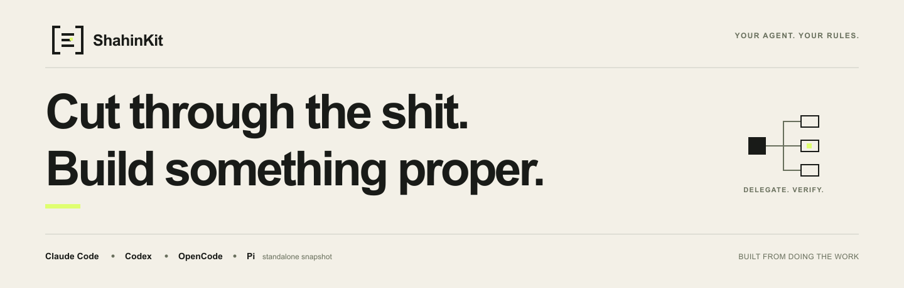
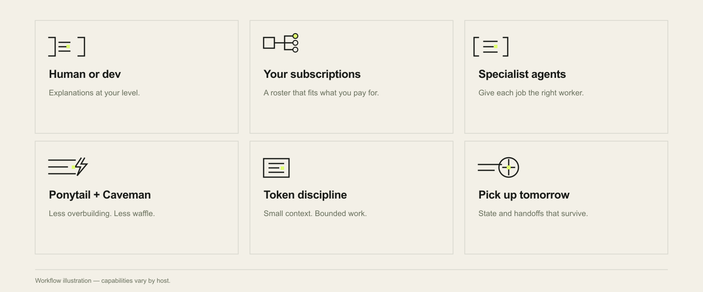

<p align="center">
  
</p>

<p align="center">
  <a href="#get-shahinkit"><strong>Get ShahinKit</strong></a> &nbsp; / &nbsp;
  <a href="https://github.com/ammarshah1n/shahinkit/archive/refs/heads/main.zip">Download ZIP</a> &nbsp; / &nbsp;
  <a href="#a-team-not-a-swarm">The agents</a> &nbsp; / &nbsp;
  <a href="#less-token-waste-by-design">Token discipline</a> &nbsp; / &nbsp;
  <a href="SETUP-GUIDE.md">Setup guide</a>
</p>

# Your agent should build the thing. Not become the project.

The internet has enough AI kits that look good in a hackathon demo. Then you try to use one for actual work: the agent forgets yesterday, overbuilds today's task, and burns your allowance explaining what it plans to do next.

I built ShahinKit because I was tired of that shit. This is the reusable part of the setup I use for real product work, shaped by the mistakes, wasted tokens, and long sessions that came with it. Not a promise that one clever prompt fixes everything. A way to get the work done properly.

**ShahinKit gives your coding agent a working method:** understand the job, choose the right specialists, keep the work bounded, check the result, and leave the next session something useful.

It fits **your subscriptions**, speaks at **your level**, and keeps **you in charge**. You don't need to become an AI tooling enthusiast to use it.

<p align="center">
  
</p>

*Workflow illustration, not an app screenshot. Features differ by host; Pi is a separate, smaller resource snapshot.*

## Get ShahinKit

**Already using Claude Code, Codex, or OpenCode?** Paste this into your agent, replacing the bracketed choices:

```text
Help me install https://github.com/ammarshah1n/shahinkit.git
for [Claude Code / Codex / OpenCode], in [this project / my user config].
Read README.md and INSTALL.md first. This is currently a development
checkout, not a signed release. Explain that distinction, preserve my
existing setup, and show me the installation preview before changing anything.
After I approve installation, run /onboard to fit it to my subscriptions
and how technical I want the explanations to be.
```

**Prefer the terminal?** You need Git, Python 3.11+ and an installed host with your own model access. Clone the kit, then preview a project-scoped Claude Code install in the project you choose:

```sh
git clone https://github.com/ammarshah1n/shahinkit.git
cd shahinkit
kit_dir="$PWD"
cd /absolute/path/to/your-project
python3 "$kit_dir/claude-code/core/scripts/manage.py" install \
  --agent claude-code --scope project \
  --allow-development-checkout --preserve-existing --preview
```

Replace `/absolute/path/to/your-project` with your project directory. Use `--agent codex` or `--agent opencode` for those hosts. **This previews changes; it does not install them.** Follow [INSTALL.md](INSTALL.md) to review the digest, explicitly trust the host, and apply. Reload or restart the chosen host once after installation.

> **Current distribution:** source checkout or [ZIP](https://github.com/ammarshah1n/shahinkit/archive/refs/heads/main.zip), not a packaged app or signed release. **Managed installs require a Git clone** with the canonical remote; the ZIP is for browsing or manually copying reviewed Pi resources. The release-signing gate is not configured. `--allow-development-checkout` explicitly opts into the development path; it is not release verification. Review the source before trusting it.

**Using Pi?** Start with the [separate Pi setup](Pi/README.md#install-safely). It explains how to try the resources in a fresh config directory without overwriting your existing setup. Pi is not part of the three-host installer.

## It starts by asking about you

Most kits hand you someone else's model choices. ShahinKit's `/onboard` asks:

- Which hosts do you use?
- What subscription tier do you pay for on each?
- Have you coded before, or would plain English be more useful?

Your answers set the specialist models, reasoning effort, and how readily the agent delegates. On a smaller allowance, cheaper workers handle suitable jobs. With more headroom, delegation can prioritise parallel work. You can pick a preset or use the bundled offline model picker to override individual roles.

**It asks, it doesn't snoop.** Subscription tiers are self-declared, not pulled from billing accounts. Run `/onboard` again when your setup changes. Model-profile changes are previewed before you approve them.

### Human mode. Dev mode. Same substance.

**Human mode** explains what a command does, what a file is for, and why an error matters. No unexplained jargon. You can concentrate on what you're making.

**Dev mode** keeps the technical language and gets on with it.

These are the plain-English and technical explanation settings, not separate products. Say **`explain simply`** or **`technical mode`** to switch. Your choice is remembered. Warnings, uncertainty, exact commands, and technical detail stay intact in either mode.

## A team, not a swarm

More agents isn't automatically better. Five workers reading the same giant conversation can be an expensive way to do one person's job.

ShahinKit gives specialists **bounded jobs and their own context**. The controller keeps the decisions that need the whole picture: architecture, security, privacy, and whether the result is actually good enough. Workers bring back evidence and changes, not permission to do whatever they like.

| Role | What it is there to do |
| :--- | :--- |
| **Controller** | Understand the brief, make the calls, accept the finished work. |
| **Research** | Find relevant code or current sources and return a useful summary. |
| **Implementation** | Build a clearly scoped piece, then verify it. |
| **Review** | Look for defects and missed requirements before the work is accepted. |
| **Mechanical** | Handle extraction, formatting, and other predictable work without expensive reasoning. |

Those are the five roles in the managed host setup. **Pi goes further on execution:** single jobs, parallel jobs, sequential chains, background results, and detached Git-worktree jobs for independent writes. Separate worktrees keep workers out of each other's files; completion notifications let the controller keep going instead of polling.

### An example from my kind of setup

You don't need all of this to start. This is an **illustrative personal Pi roster**, not the installer's defaults or a promise that your provider offers every model:

| Job | Example model | Why put it there? |
| :--- | :--- | :--- |
| Interactive controller | `openai-codex/gpt-6-astra` | Judgment, direction, and final acceptance. |
| Scout | `openai-codex/gpt-6-luna:high` | Read the code; return the useful part. |
| Mechanical work | `openai-codex/gpt-6-luna:minimal` | Don't pay for deep reasoning to reformat a list. |
| Bounded implementation | `openai-codex/gpt-6-luna:high` | A focused job with a checkable result. |
| Research / review | `openai-codex/gpt-6-luna:max` | More room for evidence gathering and scrutiny. |
| Higher-risk implementation | `anthropic/claude-sonnet-5-5` | A deliberately chosen worker for more consequential changes. |
| Difficult planning | `anthropic/claude-opus-5-5:max` | An explicit choice, not the default for everything. |

For a Claude-only setup, the same division can use **Opus for the controller, Sonnet for research/build/review, and Haiku for mechanical work**. Choose models you actually have access to.

[Shipped profiles](Pi/agents/), [managed-host presets](claude-code/core/shared/models/presets.json), and the [full roster guide](SETUP-GUIDE.md#2-subagent-rosters) are the references for your installation. They are versioned snapshots: the Pi guide and managed presets currently name different model generations. Check your host's available models rather than copying this table blindly.

## Less token waste, by design

The point isn't to make every answer cheap. It's to stop spending expensive context and reasoning on the wrong work.

- **Read less, on purpose.** `/prime` starts with the smallest useful project context instead of another indiscriminate file dump.
- **Keep worker context separate.** A scout can read a lot and return a little. The controller doesn't need every line the scout saw.
- **Match the model to the task.** Deterministic work doesn't need your strongest reasoning model.
- **Stop expanding the job.** Ponytail pushes toward the smallest correct solution, existing code first.
- **Stop writing essays about it.** Caveman trims the explanation, not the technical substance.
- **Leave usable state.** Handoffs reduce the need to reconstruct the previous session.

### Guardrails for the long sessions

The **Pi snapshot includes a runaway guard** that pauses automatic chaining when a message, cost, time, or background-turn budget is reached. It gives a warning at 75%; `/budget` shows and controls it. The bundled default limits are **250 assistant messages, $40 reported cost, 90 minutes, or 12 chained background turns per prompt**, with a tighter configurable model profile.

That's a circuit breaker, **not a hard billing cap**. Already-running jobs can finish; provider cost reporting and your configuration matter. See the [Pi implementation](Pi/extensions/turn-budget.ts).

The managed Claude Code/Codex hooks provide short session-start and worker-boundary guidance. OpenCode has native guidance and command-timeout protection. **They do not all have Pi's budget guard.**

There is no published controlled benchmark supporting a universal **8× token saving** for this kit. The mechanisms above are shipped; the amount you save depends on the task, models, host, and how you use them. I'd rather show you how it works than put a made-up multiplier on the banner.

## Ponytail and Caveman come with it

**Ponytail:** build the smallest thing that actually solves the problem. Reuse what's there. Reach for the standard library before another dependency. Don't turn a small request into an architecture project.

**Caveman:** say what matters, then stop. Code, paths, numbers, warnings, and caveats stay complete. The waffle doesn't.

Both are on by default after an approved managed install. Say `stop ponytail`, `stop caveman`, or `normal mode` for a session, or omit either at installation. They are working preferences, not a reason to skip validation, accessibility, or safety.

## Plenty beyond the headline

The main kit documents **43 skills** across its shared workflows and bundled specialist collections. Pi has **six portable skills**, plus its own agents, extensions, themes, and helpers. This isn't a claim of 43 identical commands on all four hosts.

| When you need… | Reach for… |
| :--- | :--- |
| A useful start, without guessing what happened yesterday | `/prime` |
| A vague request turned into a bounded job | `/triage` |
| A plan for a change, or a new idea checked before building | `/plan`, `/idea` |
| A deeper look at a risky or unfamiliar project | `/deep-plan`, `/deep-idea` |
| Several plans, or a larger piece of coordinated work | `/plans`, `/mission` |
| Current evidence rather than confident guessing | `/research` |
| Parallel changes without one worker trampling another | `/parallel-worktrees` |
| A second perspective and a quality check | `/collab`, `/taste-gate` |
| A checkpoint before switching gears | `/checkpoint` |
| A short close-out or a proper next-session handoff | `/miniwrap`, `/wrap-up` |
| Durable notes and the right context for the next task | `/memory`, `/context-router` |
| To correct a recurring mistake or refine the workflow | `/corrections`, `/reflect`, `/self-improve` |
| A skill for a repeated task, or an existing tool inspected | `/skill-builder`, `/audit-tool` |
| A study structure in an Obsidian vault you choose | `/study` |

Also included: a searchable skill catalogue, optional local Course-RAG tooling, bundled SwiftUI/SwiftData/Swift Testing skills, and optional local Basic Memory templates. The separate `web` helper offers Brave search, Exa research, and page fetching; API credentials and setup are your own.

**Pi extras:** a HUD for model/context/job state, four themes, image validation and size guards, session titles, optional fast mode, and helper scripts for background work. They're useful parts of the kit, not a requirement to adopt every integration.

[Browse the skill sources](claude-code/core/shared/skills/) · [Download the searchable HTML catalogue](https://raw.githubusercontent.com/ammarshah1n/shahinkit/main/SKILLS.html) and open it locally · [Pi inventory](Pi/README.md#included)

## What a normal day looks like

```text
/prime
“Here's what I want to build. Keep the first version small.”

Work through the brief. Plan if it needs a plan.
Use specialists where they help. Check what they return.

/wrap-up
```

Tomorrow's session reads the handoff instead of starting from scratch. `PROJECT_STATE.md` holds current truth, `NEXT.md` gives a concrete next action, and `HANDOFF.md` records what changed, what passed, and what is still blocked.

These are ordinary Markdown files you can inspect. Prime reads; Wrap Up writes. Hooks never run Prime or Wrap Up automatically; they remind the agent that the workflows are available. Commit and push still need your approval.

## Your setup stays yours

- **Preview before changes.** The managed installer shows paths and changes before apply, update, uninstall, or rollback.
- **Keep your customisations.** `--preserve-existing` leaves unowned files and conflicting configuration alone.
- **Install per project or per user.** Try the managed kit in a limited scope first; try Pi in a separate config directory.
- **Undo managed changes.** Receipts and backups track what the three-host installer owns. Pi remains a manual copy, not a receipt-backed install.
- **Memory is optional.** Basic Memory is off by default; its template is local-only. Markdown remains the source of truth.
- **No hidden transcript collection.** Managed lifecycle hooks do **not** record prompts, upload files, auto-commit, or auto-push. Pi background helpers do keep local job prompts/logs until cleanup; its optional integrations have their own data flows.
- **You approve consequential actions.** The kit's rules require approval for external or destructive work. Those instructions are not a sandbox or a substitute for your host's permission controls.

Your chosen model provider still processes model requests under its own terms. This is a reusable setup, not free model access or a privacy guarantee. See [installation boundaries](INSTALL.md#non-goals-and-safety) and [Pi's operational notes](Pi/README.md#notes).

## A few honest limits

ShahinKit is a set of instructions, skills, agents, hooks, and helpers for existing hosts. It isn't a new model, a desktop app, or a guarantee that an agent won't make mistakes.

The three managed adapters and the standalone Pi snapshot aren't feature-identical. Optional tools need their own dependencies and credentials. Host APIs and model names change; the [setup guide](SETUP-GUIDE.md) and shipped manifests describe the current snapshot, not perpetual compatibility. The signed-release path is not ready; use the explicitly reviewed development path above.

Third-party skills retain their [own licences and attribution](claude-code/core/third_party/). **No project-wide licence has been selected.** Public source is not the same thing as a blanket reuse licence. ShahinKit is independent of Anthropic, OpenAI, OpenCode, and Pi.

---

**You already have an agent. Give it a better way to work.**

[**Get ShahinKit →**](#get-shahinkit) · [Download ZIP](https://github.com/ammarshah1n/shahinkit/archive/refs/heads/main.zip) · [Read the setup guide](SETUP-GUIDE.md) · [Report a problem](https://github.com/ammarshah1n/shahinkit/issues)
